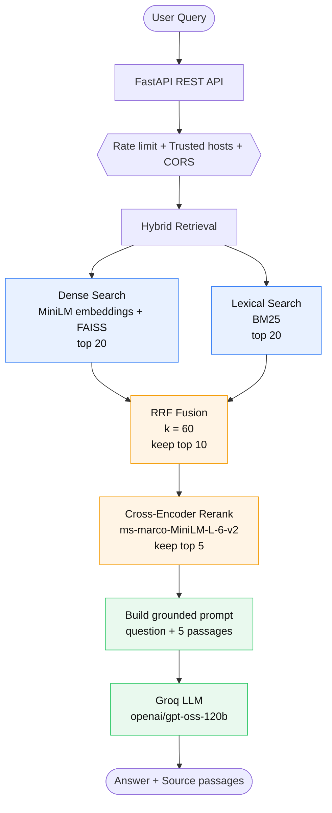
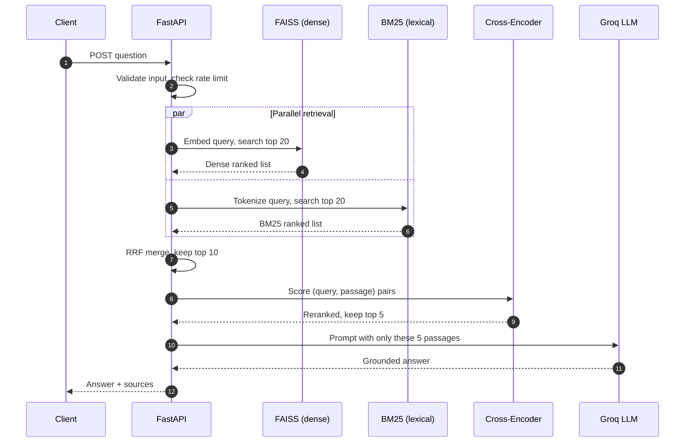
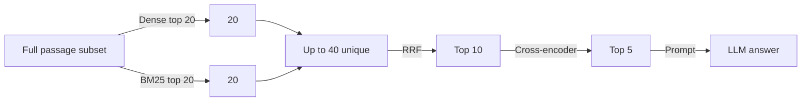
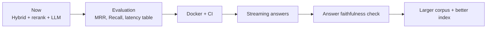

# Hybrid RAG over MS MARCO

A Retrieval-Augmented Generation (RAG) API that answers questions using only passages retrieved from an MS MARCO subset.

It combines **meaning-based search (FAISS)** and **keyword search (BM25)**, merges them with **Reciprocal Rank Fusion (RRF)**, re-scores the best candidates with a **cross-encoder**, and sends the final passages to an **LLM on Groq** to write a grounded answer with sources.


---

## Why hybrid?

| Method | Good at | Bad at |
|---|---|---|
| Dense (FAISS) | Finding passages with the same *meaning*, even with different words | Exact names, codes, rare terms |
| BM25 | Exact keyword matches | Synonyms, paraphrased questions |
| **Hybrid (RRF)** | Covers both weaknesses | Slightly more latency and complexity |
| **Cross-encoder rerank** | Picks the truly best passages from the merged list | Slow if run on too many passages, so only top candidates are reranked |

---

## Architecture



---

## Request flow



> Note: whether dense and BM25 run truly in parallel or one after another depends on the implementation in `app/`. Adjust this diagram to match the code.

---

## How the candidate list shrinks



Fusion rule used (RRF, `k = 60`):

```
score(passage) = 1 / (60 + rank_in_dense) + 1 / (60 + rank_in_bm25)
```

A passage ranked high by **both** retrievers wins. RRF only uses ranks, so you do not need to normalize FAISS and BM25 scores, which live on different scales.

---

## Tech stack

| Layer | Tool |
|---|---|
| API | FastAPI, Uvicorn, Pydantic, pydantic-settings |
| Dense retrieval | `sentence-transformers/all-MiniLM-L6-v2` + `faiss-cpu` |
| Lexical retrieval | `rank-bm25` |
| Reranker | `cross-encoder/ms-marco-MiniLM-L-6-v2` |
| LLM | Groq API, default model `openai/gpt-oss-120b` |
| Data | MS MARCO passage subset (Parquet via pandas + pyarrow) |
| HTTP client | httpx |

---

## Project structure

```
hybrid-rag-ms-marco/
├── app/            # FastAPI app, retrieval, fusion, reranking, generation
├── scripts/        # Data prep and index building
├── tests/          # Test suite
├── .env.example    # All configuration options
├── requirements.txt
└── README.md
```

<!-- TODO: expand app/ into its real files (e.g. main.py, retrieval.py, ...) after checking the code -->

---

## Quick start

### 1. Install

```bash
git clone https://github.com/manojkumargudge/hybrid-rag-ms-marco.git
cd hybrid-rag-ms-marco

python -m venv .venv
source .venv/bin/activate        # Windows: .venv\Scripts\activate
pip install -r requirements.txt
```

### 2. Configure

```bash
cp .env.example .env
# open .env and set GROQ_API_KEY
```

Get a key from the [Groq console](https://console.groq.com/).

### 3. Build data and indices

```bash
# TODO: replace with the real script names from scripts/
python scripts/<prepare_data>.py
python scripts/<build_indices>.py
```

This should produce:

- `data/passages_subset.parquet`
- `indices/dense_index.faiss`
- `indices/bm25/bm25_index.pkl`
- `indices/bm25/tokenized_corpus.pkl`

### 4. Run the API

```bash
# TODO: confirm the module path
uvicorn app.main:app --host 0.0.0.0 --port 8000
```

Open `http://localhost:8000/docs` for the interactive Swagger UI (FastAPI default).

### 5. Ask a question

```bash
# TODO: confirm the route and request body
curl -X POST http://localhost:8000/query \
  -H "Content-Type: application/json" \
  -d '{"question": "what causes the northern lights"}'
```

### 6. Run tests

```bash
pytest tests/
```

---

## Configuration

All settings come from environment variables (see `.env.example`).

### Models

| Variable | Default | Purpose |
|---|---|---|
| `GROQ_API_KEY` | none | Required. Your Groq key |
| `GROQ_MODEL` | `openai/gpt-oss-120b` | LLM used for the final answer |
| `EMBEDDING_MODEL` | `sentence-transformers/all-MiniLM-L6-v2` | Query and passage embeddings |
| `RERANKER_MODEL` | `cross-encoder/ms-marco-MiniLM-L-6-v2` | Final re-scoring |

### Retrieval tuning

| Variable | Default | Purpose |
|---|---|---|
| `RETRIEVAL_K` | `20` | Candidates fetched from each retriever |
| `HYBRID_TOP_K` | `10` | Candidates kept after RRF |
| `RERANK_TOP_K` | `5` | Passages sent to the LLM |
| `RRF_K` | `60` | RRF smoothing constant |

### Paths and versions

| Variable | Default |
|---|---|
| `PASSAGES_PATH` | `data/passages_subset.parquet` |
| `DENSE_INDEX_PATH` | `indices/dense_index.faiss` |
| `BM25_INDEX_PATH` | `indices/bm25/bm25_index.pkl` |
| `BM25_CORPUS_PATH` | `indices/bm25/tokenized_corpus.pkl` |
| `INDEX_VERSION` / `DATA_VERSION` | `v1` |
| `APPLICATION_VERSION` / `GIT_VERSION` | `1.0.0` / `unknown` |

### Reliability and security

| Variable | Default | Purpose |
|---|---|---|
| `GROQ_TIMEOUT_SECONDS` | `30` | Max wait for the LLM |
| `GROQ_MAX_RETRIES` | `2` | Retries on LLM failure |
| `RATE_LIMIT_REQUESTS` | `60` | Requests allowed per window |
| `RATE_LIMIT_WINDOW_SECONDS` | `60` | Window size |
| `TRUSTED_HOSTS` | `localhost,127.0.0.1,testserver` | Allowed Host headers |
| `CORS_ORIGINS` | empty | Allowed browser origins (empty = none) |

---

## Design decisions

- **Rank-based fusion (RRF) instead of score mixing.** Dense and BM25 scores are not comparable. Ranks are.
- **Small funnel: 20 → 10 → 5.** The cross-encoder is the slowest step. It only sees 10 passages.
- **Grounded generation.** The LLM only sees the retrieved passages, which reduces made-up answers. It does not remove them.
- **Versioned data and indices** (`DATA_VERSION`, `INDEX_VERSION`) so you can tell which index produced which answer.
- **Everything configurable by env var**, so you can tune retrieval without code changes.

---

## Known limitations

- Runs on a **subset** of MS MARCO, not the full corpus. Answers can only be as good as that subset.
- `faiss-cpu` with a flat or simple index will not scale to millions of passages without changing index type.
- Answer quality depends on an external API (Groq). If it is down or rate limited, generation fails.
- The LLM can still ignore or misread the context. No automatic faithfulness check is described yet.

<!-- TODO: add real measured numbers below. Without them, "hybrid beats dense-only" is a claim, not a result. -->

---

## Evaluation (to fill in)

Run the same queries through each variant and report the results here.

| Pipeline | MRR@10 | Recall@10 | Avg latency (ms) |
|---|---|---|---|
| BM25 only | – | – | – |
| Dense only | – | – | – |
| Hybrid (RRF) | – | – | – |
| Hybrid + rerank | – | – | – |

---

## Roadmap



---

## License

TODO: add a license (MIT is common for portfolio projects).

## Acknowledgements

- [MS MARCO](https://microsoft.github.io/msmarco/) dataset
- [Sentence-Transformers](https://www.sbert.net/)
- [FAISS](https://github.com/facebookresearch/faiss)
- [rank-bm25](https://github.com/dorianbrown/rank_bm25)
- [Groq](https://groq.com/)