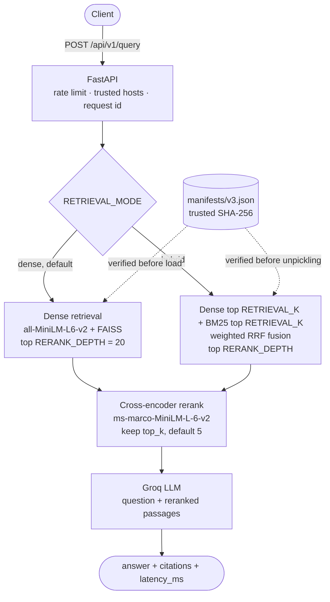

# Retrieval-augmented QA over MS MARCO

A FastAPI service that answers questions from an MS MARCO passage subset. It retrieves
candidates with a dense bi-encoder, reranks them with a cross-encoder, and prompts an LLM on
Groq to answer using the top passages. The API returns those passages as citations. Hybrid retrieval
(dense + BM25 fused with reciprocal rank fusion) is available as a configuration option.

See the [release runbook](docs/release.md), [changelog](CHANGELOG.md), and
[validation evidence](docs/evidence.md) for the v1.0.0 candidate.

## Headline result

**Served system (dense retrieval, cross-encoder rerank of the top 20): MRR@10 = 0.779
[95% CI 0.759, 0.801]** on 1,000 queries from the official MS MARCO dev-small qrels.

This was measured on a **150,000-passage subset**, not the 8.8M-passage collection:

| Passages in the corpus | Count |
|---|---|
| Relevant passages of the 1,500 sampled eval + tune queries | 1,613 |
| Hard negatives: random sample of each query's official `top1000.dev` pool | 72,967 |
| Random passages from the full collection | 75,420 |
| **Total** | **150,000** |

Because the corpus is a subset, these scores are **not comparable to full-corpus MS MARCO
leaderboard numbers**. Source: [`manifests/v3.json`](manifests/v3.json),
[`eval/results/20261118-v3-0d90c58/metrics.json`](eval/results/20261118-v3-0d90c58/metrics.json).

## Results

All numbers below come from
[`eval/results/20261118-v3-0d90c58/metrics.json`](eval/results/20261118-v3-0d90c58/metrics.json)
(per-query rankings in `per_query.jsonl` next to it): 1,000 eval queries, corpus v3, git
`0d90c58`, clean tree. Brackets are 95% bootstrap confidence intervals (10,000 resamples over
queries, seed 42). Each retriever returns its top 100; reranked systems rerank the top N of their
base ranking and keep the base order below N.

| System | MRR@10 | nDCG@10 | Recall@10 | Recall@100 | p50 ms | p95 ms |
|---|---|---|---|---|---|---|
| BM25 | 0.455 [0.428, 0.482] | 0.499 [0.473, 0.526] | 0.655 [0.626, 0.684] | 0.872 [0.851, 0.891] | 406 | 770 |
| Dense | 0.697 [0.674, 0.720] | 0.746 [0.726, 0.765] | 0.916 [0.899, 0.932] | 0.990 [0.984, 0.996] | 81 | 123 |
| Hybrid (RRF, k=60) | 0.596 [0.570, 0.622] | 0.638 [0.614, 0.662] | 0.798 [0.773, 0.822] | 0.993 [0.988, 0.997] | 496 | 872 |
| Hybrid + rerank top 10 | 0.705 [0.680, 0.731] | 0.721 [0.696, 0.745] | 0.798 [0.773, 0.822] | 0.993 [0.988, 0.997] | 870 | 1,355 |
| **Dense + rerank top 20 (served)** | **0.779 [0.759, 0.801]** | **0.815 [0.797, 0.833]** | **0.942 [0.928, 0.955]** | 0.990 [0.984, 0.996] | 787 | 1,190 |
| Dense + rerank top 50 (reference only) | 0.782 [0.761, 0.802] | 0.819 [0.801, 0.836] | 0.950 [0.936, 0.962] | 0.990 [0.984, 0.996] | 1,913 | 2,778 |

**Paired differences** (same queries, same bootstrap resamples), mean [95% CI]:

| Comparison | MRR@10 | nDCG@10 | Recall@10 |
|---|---|---|---|
| Served − dense | +0.082 [+0.063, +0.101] | +0.069 [+0.054, +0.084] | +0.026 [+0.014, +0.038] |
| Served − hybrid + rerank top 10 | +0.074 [+0.057, +0.092] | +0.094 [+0.077, +0.112] | +0.144 [+0.121, +0.167] |
| Dense + rerank top 50 − served | +0.002 [−0.002, +0.007] | +0.004 [−0.001, +0.009] | +0.008 [−0.001, +0.016] |
| Hybrid − BM25 | +0.141 [+0.125, +0.158] | +0.139 [+0.125, +0.154] | +0.143 [+0.122, +0.164] |
| Hybrid − dense | −0.101 [−0.123, −0.078] | −0.107 [−0.127, −0.087] | −0.118 [−0.142, −0.094] |
| Hybrid + rerank top 10 − hybrid | +0.109 [+0.091, +0.127] | +0.082 [+0.069, +0.095] | 0 (rerank only reorders the top 10) |

How to read this:

- **Reranking dense top 20 improves on dense alone:** +0.082 MRR@10, CI excludes 0, at a cost of
  about 700 ms at p50 on this CPU.
- **Rerank top 50 vs top 20:** the CI includes 0, so no improvement is shown; it is about 2.4×
  slower at p50. Top 50 is reported for reference and was not eligible for serving.
- **Hybrid vs dense with reranking:** the served-vs-hybrid + rerank top 10 difference is
  confounded by rerank depth (20 vs 10), so it does **not** show that hybrid retrieval is worse.
  At a matched rerank depth of 50 on the tune split, weighted-RRF + rerank and dense + rerank
  had an MRR@10 difference of +0.0005 [−0.0028, +0.0056]
  ([`eval/results/20261117-v3-tune-c858705/metrics.json`](eval/results/20261117-v3-tune-c858705/metrics.json)).
  Hybrid stays available as `RETRIEVAL_MODE=hybrid`.
- Every hard negative in the subset was sampled from the official `top1000.dev` BM25 candidate
  pools. The sampling method can affect comparisons between BM25, dense and hybrid retrieval.
- **Latency** is CPU-only (Intel i5-1235U, 12 logical CPUs, 10 torch threads, 15.7 GB RAM,
  Windows build 26200). Queries run one at a time in a single process. In hybrid mode, dense and BM25 run
  sequentially. Generation (Groq) is not included. Per-stage p50/p95: dense 81/123 ms, BM25
  406/770 ms, rerank of 20 dense candidates 697/1,103 ms.
- MS MARCO qrels are sparse (about one judged passage per query), so unjudged relevant passages
  count as misses.

### How the served configuration was chosen

The configuration was selected on a **separate tune split** (500 dev-small queries, disjoint
from the 1,000 eval queries). The eval split was then run once with the chosen system. The
selection rules were committed before the eval run
([`evaluation/tune_select.py`](evaluation/tune_select.py)):

1. **Grid:** dense + rerank and weighted-RRF + rerank (dense weight 0.5–0.9), at rerank depths
   10, 20 and 50.
2. **Hybrid vs dense:** serve weighted-RRF only if it beats the best dense + rerank on tune
   with a paired 95% CI of the MRR@10 difference entirely above 0. It did not (see above).
3. **Latency rule:** serve the smallest rerank depth within 0.01 MRR@10 of the best on tune.
   On tune, depth 50 scored 0.8003 and depth 20 scored 0.7925, so depth 20 is served.

## Architecture

The [architecture decisions](docs/architecture-decisions.md) record the rationale and tradeoffs.



At startup each worker checks the passage file and FAISS index SHA-256 against both the
mounted build manifest and the committed `manifests/v3.json`. Hybrid mode also checks both
BM25 pickles and deserializes the verified bytes. A missing required artifact or digest
mismatch prevents the worker from serving traffic. The container includes the trusted
manifest in the image. Keep the host artifact files immutable while a worker starts.

## API

| Method | Path | Auth | Purpose |
|---|---|---|---|
| `POST` | `/api/v1/query` | `X-API-Key` | Answer a question |
| `GET` | `/metadata` | `X-API-Key` | Model names, artifact versions, retrieval mode, rerank depth |
| `GET` | `/metrics` | `X-API-Key` | Prometheus metrics (see [Operations](#operations)) |
| `GET` | `/health` | open | Liveness |
| `GET` | `/ready` | open | Reports whether the worker can serve queries |
| `GET` | `/docs`, `/openapi.json` | open | Swagger UI and the OpenAPI schema |

**Authentication is the default for every path.** Only `/health`, `/ready`, `/docs` and
`/openapi.json` are open, from an explicit allowlist in the outermost middleware
([`app/middleware.py`](app/middleware.py)). Any other path, including routes added later, needs
the configured `API_KEY` in the `X-API-Key` header. CORS preflight requests are exempt.
The server uses a constant-time comparison. Missing or wrong keys receive 401, subject to
the request rate limit. If `API_KEY` is empty, protected routes fail closed.
For existing deployments, replace `API_KEYS` with a single `API_KEY` in the service environment.

The request body requires a nonblank `query` string of up to `MAX_QUERY_CHARS` characters
(default 2,000). Optional `top_k` is an integer from 1 to 20, defaults to 5, and caps the
number of passages sent to the LLM and returned as citations.

```bash
curl -X POST http://localhost:8000/api/v1/query \
  -H "Content-Type: application/json" \
  -H "X-API-Key: ${API_KEY}" \
  -d '{"query": "what are the symptoms of diabetes?", "top_k": 5}'
```

Response shape:

```json
{
  "answer": "… [pid:123]",
  "citations": [{"passage_id": 123, "passage_text": "…", "score": 8.75}],
  "latency_ms": 812.4,
  "error": null
}
```

If generation fails or the Groq circuit is open, the response is **200 with the reranked
passages**, `"answer": null` and an `error` of `generation_failed` or
`generation_circuit_open`. The same response shape carries `invalid_answer_citations`,
`insufficient_evidence`, or `low_retrieval_confidence` when the answer is withheld.

| HTTP | Example response and headers |
|---|---|
| 400 | `{"detail":"Query cannot be empty."}` for a whitespace-only query |
| 401 | `{"detail":"Invalid or missing API key."}` with `WWW-Authenticate: ApiKey` |
| 413 | `{"detail":"Request body exceeds the byte limit."}` when the streamed query body exceeds `MAX_QUERY_BODY_BYTES` |
| 422 | `{"detail":[{"type":"int_type","loc":["body","top_k"],"msg":"Input should be a valid integer","input":"5"}]}` for a string `top_k`. Validation entries include `loc`, `type`, and `msg`. Other fields may vary. |
| 429 | `{"detail":"Rate limit exceeded."}` with `Retry-After: 60`, or `{"detail":"Query concurrency limit exceeded."}` with `Retry-After: 1` |
| 503 | Query returns `{"detail":"RAG service is not ready."}` or `{"detail":"RAG service is shutting down."}`. `/ready` returns `{"status":"not_ready","service":"hybrid-rag"}`. |

Unexpected pipeline failures may also return 500 or 502 with a JSON `detail` string.

## Quick start (Docker Compose)

```bash
git clone https://github.com/manojkumargudge/hybrid-rag-ms-marco.git
cd hybrid-rag-ms-marco
python scripts/fetch_artifacts.py    # Download and verify the v3 release artifacts
cp .env.example .env                 # set GROQ_API_KEY; set API_KEY to a strong random value
docker compose up --build -d
curl http://localhost:8000/ready
curl -X POST http://localhost:8000/api/v1/query \
  -H "Content-Type: application/json" -H "X-API-Key: ${API_KEY}" \
  -d '{"query": "what are the symptoms of diabetes?"}'
```

- **`fetch_artifacts.py`** needs only the Python standard library. It downloads the prebuilt
  corpus v3 from the GitHub release
  [`v3-artifacts`](https://github.com/manojkumargudge/hybrid-rag-ms-marco/releases/tag/v3-artifacts)
  into `artifacts/v3/`. Every file must match the SHA-256 in the committed
  [`manifests/v3.json`](manifests/v3.json). A mismatch exits nonzero and discards any temporary
  download. Existing files are preserved. See [Data](#data) for the terms.
- Set `API_KEY` in your client shell to the value configured on the server before running curl.
  `API_PORT` in `.env` sets the host port (default 8000).
- **The image** installs hash-locked CPU-only dependencies and bakes in the pinned model
  revisions; it runs with Hugging Face offline mode. `artifacts/v3` is mounted read-only, never
  copied into the image.

### Run without Docker

```bash
python -m venv .venv
source .venv/bin/activate            # Windows: .venv\Scripts\activate
pip install -r requirements-dev.txt
python scripts/fetch_artifacts.py
cp .env.example .env                 # set GROQ_API_KEY and API_KEY
uvicorn app.main:app --host 127.0.0.1 --port 8000 --no-proxy-headers --no-access-log
```

### Build corpus v3 from source instead

`fetch_artifacts.py` is optional. The same artifacts can be rebuilt from the official MS MARCO
files (1,057,717,952 + 687,414,398 bytes, MD5-checked against the values recorded by
ir_datasets; needs several GB of free disk):

```bash
python -m scripts.download_msmarco                       # -> artifacts/raw/
python -m scripts.prepare_data                           # -> artifacts/v3/ (passages, query splits, qrels)
python -m scripts.build_indices --only bm25              # BM25 index
python -m scripts.build_indices --only dense             # FAISS index (CPU: 3,295 s on the eval laptop)
python -m scripts.verify_artifacts                       # sha256 + row-count checks
```

Seed 42, the sampling rules and the pinned model revisions are recorded in
`artifacts/v3/manifest.json` (committed copy: [`manifests/v3.json`](manifests/v3.json)). The
data preparation and index scripts require `--force` to overwrite existing outputs. The FAISS index of a rebuild may not be
byte-identical on different CPUs. Use `fetch_artifacts.py` for the exact published files.
To serve a reviewed rebuild, set `TRUSTED_MANIFEST_PATH` to an independently managed copy of
its manifest. Keep that reference outside the artifact directory and under deployer control.

### Reproduce the evaluation

```bash
python -m evaluation.tune_select     # tune split only: config selection
python -m evaluation.run_eval        # eval split: writes eval/results/<date>-v3-<commit>/
```

`run_eval --estimate 20` times 20 queries and writes nothing. The full eval spent 2,753 s
(about 46 minutes) loading models and running queries on the hardware above
(`timing_seconds` in its `metrics.json`).

## Data

The corpus is derived from [MS MARCO](https://microsoft.github.io/msmarco/). Under its terms the
MS MARCO datasets are intended for **non-commercial research purposes only** and come without
any license or other intellectual property rights. Use of the
[`v3-artifacts`](https://github.com/manojkumargudge/hybrid-rag-ms-marco/releases/tag/v3-artifacts)
release is subject to those terms. This repository's MIT license covers the code, not the data.
If you use the data, cite Bajaj et al., *MS MARCO: A Human Generated MAchine Reading
COmprehension Dataset*, 2016 (arXiv:1611.09268).

**If Microsoft or a document owner asks, this release will be removed; build-from-source path
remains** ([Build corpus v3 from source](#build-corpus-v3-from-source-instead)). Document owners
can also contact ms-marco@microsoft.com.

## Configuration

All settings are environment variables (see [`.env.example`](.env.example)).

| Variable | Default | Purpose |
|---|---|---|
| `GROQ_API_KEY` | empty | Required for answers |
| `API_KEY` | empty | Key accepted in `X-API-Key`. Protected routes fail closed when empty. |
| `API_PORT` | `8000` | Docker Compose host port (the container always listens on 8000) |
| `GROQ_MODEL` | `openai/gpt-oss-120b` | LLM for the final answer |
| `GROQ_TIMEOUT_SECONDS` / `GROQ_MAX_RETRIES` | `10` / `2` | Per-attempt LLM timeout; retries on timeouts, 429 and 5xx only (backoff 0.2 s, 0.4 s, …) |
| `GENERATION_DEADLINE_SECONDS` | `20` | Total budget for all LLM attempts and backoff; then the passages are returned with `answer: null` |
| `EMBEDDING_MODEL` / `EMBEDDING_MODEL_REVISION` | `sentence-transformers/all-MiniLM-L6-v2` @ `1110a243…` | Dense encoder (pinned commit) |
| `RERANKER_MODEL` / `RERANKER_MODEL_REVISION` | `cross-encoder/ms-marco-MiniLM-L-6-v2` @ `233902d2…` | Cross-encoder (pinned commit) |
| `RETRIEVAL_MODE` | `dense` | `dense` or `hybrid` |
| `RERANK_DEPTH` | `20` | Candidates the cross-encoder reranks |
| `RERANK_BATCH_SIZE` | unset | Optional per-query cross-encoder batch size. Unset uses the model library default. |
| `DENSE_MIN_RERANK_SCORE` | unset | Optional dense-only cutoff for the top reranker score before generation. |
| `RERANK_TOP_K` | `5` | Fallback for direct service calls that omit `top_k`. The HTTP API defaults to 5 independently. |
| `RETRIEVAL_K` | `20` | Hybrid only: candidates from each retriever before fusion |
| `RRF_K` | `60` | Hybrid only: RRF constant |
| `HYBRID_DENSE_WEIGHT` | `0.5` | Hybrid only: dense weight in RRF (0.5 = standard RRF) |
| `MANIFEST_PATH`, `PASSAGES_PATH`, `DENSE_INDEX_PATH`, `BM25_INDEX_PATH`, `BM25_CORPUS_PATH` | `artifacts/v3/…` | Artifact locations; BM25 files are needed only in hybrid mode |
| `INDEX_VERSION` / `DATA_VERSION` | `v3` | Reported by `/metadata` |
| `APPLICATION_VERSION` / `GIT_VERSION` | `1.0.0` / `unknown` | Reported by `/metadata` |
| `RATE_LIMIT_PER_MIN` | `60` | Requests per minute per API key (per client IP when unauthenticated); `0` disables |
| `MAX_QUERY_CHARS` | `2000` | Longest accepted `query`; longer gets 422 |
| `MAX_QUERY_BODY_BYTES` | `32768` | Maximum streamed bytes for a query request, checked before JSON parsing |
| `TRUSTED_HOSTS` | `localhost,127.0.0.1,testserver` | Allowed `Host` headers |
| `CORS_ORIGINS` | empty | Allowed browser origins (empty = none) |

## Project layout

```
app/                 FastAPI app, retrievers, reranker, generator, artifact verification
scripts/             fetch_artifacts, download_msmarco, prepare_data, build_indices, verify_artifacts, lock_deps, security_audit
scripts/manual/      smoke tests that need real artifacts, models or network
evaluation/          metrics, run_eval (eval split), tune_select (tune split)
eval/results/        committed metrics.json + per_query.jsonl for each run
manifests/           committed artifact manifests (v3 served; v2 superseded)
tests/               hermetic tests (tiny MS MARCO-format fixture; no network or models)
```

## Development

```bash
ruff check app evaluation tests scripts
mypy --strict app/artifacts.py app/generation/citations.py
coverage run --source=app -m pytest -q
coverage report --fail-under=90
```

CI runs lint, scoped strict type checks, a 90% application line coverage gate, a
lockfile-drift check, and the security audit below. Dependencies are pinned in
`requirements.txt` / `requirements-dev.txt` and hash-locked for Linux in `requirements*.lock`
(regenerate with `scripts/lock_deps.sh`).

The [OpenAPI snapshot](docs/openapi.json) is checked against the served
`/openapi.json` in pytest. After an intentional schema change, regenerate it with
`python -m scripts.export_openapi` and commit the updated snapshot.

### Offline Docker smoke test

The Docker job runs on pull requests and pushes to `main`. To reproduce it from the
repository root with a running Docker daemon, use these commands.

```bash
docker build -t hybrid-rag:ci .
python -m scripts.fetch_artifacts --dense-only
python -m scripts.docker_smoke --image hybrid-rag:ci
```

The image build downloads the pinned model revisions. The fetch command downloads
only the dense index, passages, and complete v3 manifest, with SHA-256 verification
against the committed manifest. The smoke driver then starts the image with
`--network none`, a read-only artifact mount, and a test-only Groq replacement.
It checks Docker health, `/health`, `/ready`, API-key enforcement, and the exact
ordered top 10 for four saved evaluation queries. One query is held in flight
until Uvicorn begins draining after SIGTERM. Its response must finish before the
provider closes and the container exits. The driver also checks the configured
2 CPU and 4 GiB limits in Docker metadata and requires startup failure with
missing or corrupt artifacts.

## Performance benchmark

Run from the repository root with the published v3 artifacts and both pinned model snapshots
already cached. The benchmark starts Uvicorn on loopback, pins both model revisions and
the CPU device independently of local model overrides, and loads the real models and
FAISS index, and sends authenticated `POST /api/v1/query` requests. Generation is stubbed
and Hugging Face runs offline. The benchmark sets dense retrieval, rerank depth 20, and
`top_k=10`. It keeps the per-worker admission cap at 2 and disables the per-minute rate
limit for this local run so 429s measure saturation.

```bash
python -m pip install psutil==7.0.0
python -m scripts.load_test --output eval/results/local-p4/metrics.json --requests 40 --threads 4 --parity-queries 0
python -m scripts.load_test --output eval/results/local-p4-parity/metrics.json --threads 4 --parity-only --variant baseline --variant reranker-batch-8
```

The matrix varies one setting at a time from the baseline of one worker, uncached
embeddings, and the library's reranker batch size of 32. The alternatives use a
256-entry embedding LRU, batch size 8 for the 20 reranking candidates, or two Uvicorn
workers. All settings are confined to the benchmark process.

For each configuration, the harness warms up with ten requests and runs 1, 5, and
20 closed-loop clients with persistent connections. About half the requests come
from five repeated queries. Each client waits one second after a 429 before its
next scheduled attempt. The report separates successful throughput from attempted
throughput and computes nearest-rank p50/p95/p99 on successful HTTP responses. It
samples the sum of process-tree RSS every 100 ms, so shared pages can be counted
more than once. Cold start runs from process launch to all workers initialized and a
successful readiness response, with model and filesystem caches left in place.
Parity checks use saved rankings with no accuracy evaluation rerun.

The recorded CPU run used an Intel Core i5-1235U laptop (10 cores, 12 logical CPUs,
15.73 GiB RAM, Windows build 26200), Python 3.11.9, and four Torch/OpenMP threads per
worker. It used the published 150,000-passage MS MARCO v3 subset and the pinned
MiniLM model revisions in `app/config.py`. The run sent 40 attempts per condition.

| Configuration | Successful requests/s at 1 / 5 / 20 clients | HTTP 429 at 1 / 5 / 20 clients | Cold start | Peak load RSS |
|---|---:|---:|---:|---:|
| Baseline | 0.749 / 1.209 / 1.102 | 0 / 24 / 36 | 32.32 s | 1,144 MiB |
| Embedding LRU | 0.752 / 1.318 / 1.134 | 0 / 24 / 36 | 30.18 s | 1,141 MiB |
| Reranker batch size 8 | 1.028 / 1.720 / 1.361 | 0 / 24 / 36 | 31.46 s | 1,057 MiB |
| Two workers | 0.746 / 1.284 / 1.271 | 0 / 19 / 32 | 33.94 s | 2,244 MiB |

The [raw load results](eval/results/20261122-p4-windows/metrics.json) include p50,
p95, p99, startup RSS, per-load memory, and attempted throughput. Every failure in
this run was a capacity 429. The 20-client tails are descriptive only because each
case had four to eight successful responses. Batch size 8 reduced single-client
p50 from 1,194 ms to 929 ms. The LRU barely changed single-client throughput, and a
second worker nearly doubled peak memory and raised successful-request latency at
5 and 20 clients.

`RERANK_BATCH_SIZE=8` is available as an opt-in. It passes the same batch-size
argument used by the timed experiment, with the served candidate count and API
contract unchanged. The final opt-in produced the same ordered top 10 as the
baseline and the saved evaluation for all 200 parity queries. The two parity runs
record their passage IDs by query. Their startup timings are excluded from the
load comparison. [Baseline parity](eval/results/20261122-p4-parity-baseline/metrics.json)
and [batch-size-8 parity](eval/results/20261122-p4-parity-batch8/metrics.json).

## Answer grounding and abstention

The prompt asks for one plain-text claim per line, each ending with one or more
`[pid:123]` references. The service withholds a generated answer when a claim line
is uncited, has multiple apparent sentences, or cites an ID absent from the returned
passages. The service also withholds the answer when the provider explicitly reports
insufficient evidence. These checks establish citation format and membership. A
valid citation can still point to evidence that fails to support the claim.

For dense retrieval, `DENSE_MIN_RERANK_SCORE` can skip Groq when the highest reranker
score is below a calibrated cutoff. The response retains the same ranked passages.
The option is unset by default. The calibration applies to the published v3 corpus,
default MiniLM revisions, dense retrieval, and rerank depth 20.

```bash
HF_HUB_OFFLINE=1 TRANSFORMERS_OFFLINE=1 CUDA_VISIBLE_DEVICES="" OMP_NUM_THREADS=4 MKL_NUM_THREADS=4 \
  python -m evaluation.calibrate_abstention --output eval/results/local-p5-tune --threads 4
python -m evaluation.prepare_faithfulness_review --output offline-review.jsonl
```

The calibration uses only the official v3 TUNE queries and qrels. It maximizes
abstentions within a 0.01 effective MRR@10 loss budget. Effective MRR counts
abstained queries as zero, while answered-only MRR uses only the covered queries.
Retrieval rankings are unchanged by the confidence gate.

On 500 TUNE queries, the selected cutoff was `1.9534612894058228`, which
abstained on 11 queries (2.2%). Baseline MRR@10 was 0.79155 and effective MRR@10
was 0.78259, a decrease of 0.00895. Answered-only MRR@10 was 0.80020.
[Calibration results](eval/results/20261122-p5-tune/metrics.json)

The [30-query review](eval/results/20261122-p5-faithfulness/per_query.jsonl) uses the
first 30 saved EVAL queries for a separate offline spot check. It takes an extract
from each top-ranked passage, applies the citation check, and manually labels
source support and responsiveness. All 30 passed the citation check. The review
found 21 source-supported claims and 9 fragments without a substantive claim.
Ten excerpts answered fully, 4 answered partially, and 16 did not answer. The
cited passage had a positive official qrel in 21 cases. These labels describe
offline extracts. Live Groq output quality remains unmeasured.

## Operations

For single-host releases, see the [deployment runbook](docs/deployment.md),
[rollback runbook](docs/rollback.md), and [monitoring and incident response](docs/operations.md).
Stage the approved registry digest with the matching read-only v3 bundle and a
private runtime environment file. The production Compose profile binds to
loopback and drops Linux capabilities. Open ingress through the TLS gateway
after readiness, authenticated probes, and rollback prerequisites are verified.
Record target-host sign-off in the [production checklist](docs/production-checklist.md).

**Probes.**
- `/health` returns 200 for valid hosts while the process serves.
- `/ready` returns 200 when both keys are configured, the required files exist, and the
  initialized worker is accepting queries. Startup verifies SHA-256 and loads both models
  before accepting HTTP traffic. A failed readiness check returns 503. Probes are public
  and rate-limit exempt. Readiness sends no Groq request and stays healthy during a provider outage.

**Concurrency and shutdown.** A worker admits up to `MAX_CONCURRENT_QUERIES` validated queries
(default 2) at a time. Excess queries receive 429 with `Retry-After: 1`. The app returns 503
if it receives a query while draining. On SIGTERM, Uvicorn stops accepting connections and
drains in-flight requests before the app closes the Groq client and releases the pipeline.
Compose gives the process 45 seconds before a forced stop and defaults to 2 CPUs and 4 GiB of
memory. Override the limits with `API_CPUS` and `API_MEMORY_LIMIT`.

**Logs.** The app's default logging handler writes one JSON object per line to stderr, with `timestamp`, `level`, `logger`, `message`,
`request_id` and `key_id`, plus context fields such as `method`, `path`, `status_code`,
`latency_ms`, `stage`, `stage_ms` and `error_type`.
Request logs use the matched route template for `path`, or `-` when no route was matched.
- **`request_id`:** taken from the `X-Request-ID` request header if it matches
  `[A-Za-z0-9._:-]{1,64}` and contains neither the supplied nor the configured API key.
  Otherwise, the service generates the ID. It is returned in the `X-Request-ID` response
  header and stamped on every log line of that request.
- **`key_id`:** `sha256(API key)[:8]` for authenticated requests, `-` otherwise. The raw key is
  never logged; a test checks this for both valid and invalid keys.

Example:

```json
{"timestamp":"…","level":"INFO","logger":"app.middleware","message":"request_complete","request_id":"req-abc-123","key_id":"1a2b3c4d","method":"POST","path":"/api/v1/query","status_code":200,"latency_ms":812.4}
```

**Metrics** (`GET /metrics`, Prometheus text format, requires `X-API-Key`):

| Metric | Type | Labels |
|---|---|---|
| `rag_stage_latency_seconds` | histogram | `stage` = `retrieve`, `rerank`, `generate` |
| `rag_errors_total` | counter | `type` = `unauthorized`, `rate_limited`, `query_capacity_exceeded`, `service_unavailable`, `invalid_request`, `generation_failed`, `generation_circuit_open`, `groq_timeout`, `pipeline_error`, `invalid_answer_citations`, `insufficient_evidence`, `low_retrieval_confidence` |
| `http_requests_total` | counter | `status` |
| `http_request_duration_seconds` | histogram | None |

`rag_errors_total{type="rate_limited"}` counts each request rejected by the rate limiter.
`rag_errors_total{type="groq_timeout"}` counts each timed-out Groq attempt, including retries.
`rag_errors_total{type="generation_failed"}` counts each query that returns passages without
an answer due to a generation failure.

**Rate limit.** Sliding 60-second window, `RATE_LIMIT_PER_MIN` requests per API key.
Unauthenticated requests are limited per client IP, which also slows down key guessing. Over
the limit gets 429 with `Retry-After: 60`. The removed settings `RATE_LIMIT_REQUESTS` and
`RATE_LIMIT_WINDOW_SECONDS` are ignored; if either is set (environment or `.env`), startup
logs a warning naming `RATE_LIMIT_PER_MIN`.

**Client IP and `X-Forwarded-For`.** The per-IP bucket uses `request.client.host`, the TCP
peer, and never reads `X-Forwarded-For`. uvicorn's default proxy-header handling would
otherwise replace `request.client.host` with a client-supplied `X-Forwarded-For` for
connections from 127.0.0.1. So every launch here disables it (`--no-proxy-headers` in the
Dockerfile and the README command, `proxy_headers=False` in `scripts/manual/serve_no_llm.py`).
A test checks that a spoofed `X-Forwarded-For` doesn't reset the limit, both in-process and
through uvicorn. Behind a trusted reverse proxy, every client then shares the proxy's IP
bucket. To limit per real client, enable proxy headers only with `FORWARDED_ALLOW_IPS` set to
the proxy's address.

**LLM timeouts and fallback.**
- Each Groq attempt has a `GROQ_TIMEOUT_SECONDS` timeout (default 10).
- **Only timeouts, 429 and 5xx are retried**, up to `GROQ_MAX_RETRIES` (default 2) times, with
  exponential backoff (0.2 s, 0.4 s). Other 4xx and non-timeout errors fail immediately.
- All attempts and sleeps share a `GENERATION_DEADLINE_SECONDS` budget (default 20). Each
  attempt's configured timeout is capped by the time left. The generator checks the budget
  before starting an attempt or sleeping for backoff.
- If generation still fails, the API returns the reranked passages with `answer: null`,
  `error: "generation_failed"`, and increments `rag_errors_total{type="generation_failed"}`.
- After `GROQ_BREAKER_FAILURE_THRESHOLD` consecutive failed generations (default 3),
  the worker skips Groq for `GROQ_BREAKER_COOLDOWN_SECONDS` (default 30). Skipped requests
  return HTTP 200 with the same reranked passages, `answer: null`, and
  `error: "generation_circuit_open"`. One request probes Groq after the cooldown.
  Success restores generation and failure starts a fresh cooldown.

**Scaling: the limiter is in-memory, per process.** Each uvicorn worker and each container
keeps its own counters. With N workers or instances, a key can make up to N ×
`RATE_LIMIT_PER_MIN` requests per minute. Multi-worker or multi-instance deployments need a
shared store such as **Redis** for a global quota. An optional Redis backend would need
atomic quota updates, key expiration and explicit handling of Redis outages. The single-worker
deployment uses the existing in-memory limiter. Query concurrency and circuit state also
apply per process. Each worker or instance needs its own scrape target because the
Prometheus registry is local to the process.

## Security

The CI `security` job runs [`scripts/security_audit.sh`](scripts/security_audit.sh):

- **pip-audit** (2.10.1) on both lockfiles (`requirements.lock`, `requirements-dev.lock`) in
  `--strict` mode, so any package it cannot audit fails the job. Nothing is installed:
  `--require-hashes --disable-pip`.
- **bandit** (1.9.4) on `app/` at medium severity and above (`-ll`). The gate fails on
  scanner errors, unapproved findings and expired exceptions.
- [**Gitleaks**](scripts/scan_release_secrets.sh) scans the tracked tree and all commits reachable
  from the CI checkout, including changes introduced by merge commits. Tracked-tree
  exceptions match specific public checksums or synthetic data. History exceptions
  match the exact scanner rule, path, and commit fingerprint. The job prints finding
  metadata only.

The Docker job runs [**Trivy**](scripts/scan_image_security.sh) on the same local image
it builds and smoke-tests. Every high or critical finding blocks CI unless covered by
a documented, unexpired exception for the exact vulnerability, target type, package,
and installed version. Findings with a newly available fix require fresh review.
The JSON report is retained with the CI run for 14 days.
The Dockerfile applies Debian's [zlib security update](https://security-tracker.debian.org/tracker/DSA-6613-1).
Current Debian exceptions and their review dates are recorded in
[the security ignore file](.github/security-ignore.json).

Dependabot checks Python, GitHub Actions, and Docker dependencies weekly. Dependency
PRs follow the normal review and validation process.

Run it locally with `pip install pip-audit==2.10.1 bandit==1.9.4 && sh scripts/security_audit.sh`.

Accepted findings and workarounds, each with its reason:

| Tool | Finding | Where | Decision and reason |
|---|---|---|---|
| bandit | B301, pickle deserialization (medium) | `app/retrieval/bm25_retriever.py`, both `pickle.load` calls | **Two scoped exceptions in [the security ignore file](.github/security-ignore.json) expire on 2026-12-31.** The service checks both pickles against trusted SHA-256 digests before loading them and mounts artifacts read-only. Keep the trusted manifest and the mounted files under deployer control. |
| bandit | B403, `import pickle` (low) | same file | Below the `-ll` gate; same reason as B301. |
| pip-audit | `torch==2.13.0+cpu` cannot be looked up | both lockfiles | **Audited as `torch==2.13.0`.** `+cpu` is a local version from the PyTorch CPU index and isn't on PyPI. The script audits a temporary copy of each lockfile with the suffix removed (same upstream release, CPU-only build) and fails if that copy is empty or lost torch. |

Other measures:
- API-key auth fails closed (see [API](#api)).
- Artifacts are SHA-256-verified before load.
- Models are pinned to commit SHAs and baked into the image, which runs offline as a non-root user.
- Dependencies are hash-locked.

## Limitations

- The corpus is a 150k-passage subset, so absolute scores are not comparable to full-corpus
  results.
- Hard negatives come from BM25 candidate pools.
- The saved EVAL latency was measured sequentially on one laptop CPU. The separate
  [P4 load benchmark](#performance-benchmark) covers 1, 5, and 20 clients with
  generation stubbed. GPU performance remains unmeasured.
- The rate limiter is in-memory and per process; multi-worker or multi-instance deployments
  need Redis (or similar) to share it. Unauthenticated requests are keyed on the TCP peer, so
  behind a proxy they share one bucket.
- Answers depend on an external LLM API. Citation checks validate references to
  returned passages. Claim-level entailment remains unverified.

## History

An earlier 20-query evaluation used relevance labels judged by hand from this pipeline's own
top-5 results, so its Recall@5 was 1.0 by construction. It is kept only as history in
[`evaluation/selfjudged/`](evaluation/selfjudged/) and is not used for any result above.

## License

[MIT](LICENSE).

## Acknowledgements

[MS MARCO](https://microsoft.github.io/msmarco/) ·
[Sentence-Transformers](https://www.sbert.net/) ·
[FAISS](https://github.com/facebookresearch/faiss) ·
[rank-bm25](https://github.com/dorianbrown/rank_bm25) ·
[Groq](https://groq.com/)
