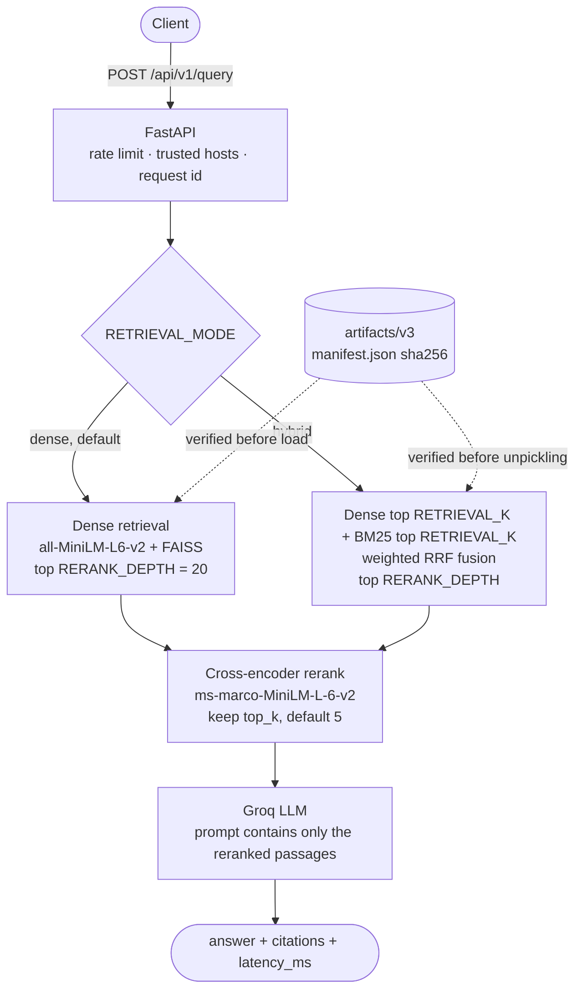

# Retrieval-augmented QA over MS MARCO

A FastAPI service that answers questions from an MS MARCO passage subset. It retrieves
candidates with a dense bi-encoder, reranks them with a cross-encoder, and has an LLM on Groq
write an answer grounded in the top passages, returned with citations. Hybrid retrieval
(dense + BM25 fused with reciprocal rank fusion) is available as a configuration option.

## Headline result

**Served system (dense retrieval, cross-encoder rerank of the top 20): MRR@10 = 0.779
[95% CI 0.759, 0.801]** on 1,000 queries from the official MS MARCO dev-small qrels.

This was measured on a **150,000-passage subset**, not the 8.8M-passage collection:

| Passages in the corpus | Count |
|---|---|
| Relevant passages of the 1,500 sampled eval + tune queries | 1,613 |
| Hard negatives: random sample of each query's official `top1000.dev` pool | 72,967 |
| Random passages from the full collection | 75,420 |
| **Total** | **150,000** |

Because the corpus is a subset, these scores are **not comparable to full-corpus MS MARCO
leaderboard numbers**. Source: [`manifests/v3.json`](manifests/v3.json),
[`eval/results/20261118-v3-0d90c58/metrics.json`](eval/results/20261118-v3-0d90c58/metrics.json).

## Results

All numbers below come from
[`eval/results/20261118-v3-0d90c58/metrics.json`](eval/results/20261118-v3-0d90c58/metrics.json)
(per-query rankings in `per_query.jsonl` next to it): 1,000 eval queries, corpus v3, git
`0d90c58`, clean tree. Brackets are 95% bootstrap confidence intervals (10,000 resamples over
queries, seed 42). Each retriever returns its top 100; reranked systems rerank the top N of their
base ranking and keep the base order below N.

| System | MRR@10 | nDCG@10 | Recall@10 | Recall@100 | p50 ms | p95 ms |
|---|---|---|---|---|---|---|
| BM25 | 0.455 [0.428, 0.482] | 0.499 [0.473, 0.526] | 0.655 [0.626, 0.684] | 0.872 [0.851, 0.891] | 406 | 770 |
| Dense | 0.697 [0.674, 0.720] | 0.746 [0.726, 0.765] | 0.916 [0.899, 0.932] | 0.990 [0.984, 0.996] | 81 | 123 |
| Hybrid (RRF, k=60) | 0.596 [0.570, 0.622] | 0.638 [0.614, 0.662] | 0.798 [0.773, 0.822] | 0.993 [0.988, 0.997] | 496 | 872 |
| Hybrid + rerank top 10 | 0.705 [0.680, 0.731] | 0.721 [0.696, 0.745] | 0.798 [0.773, 0.822] | 0.993 [0.988, 0.997] | 870 | 1,355 |
| **Dense + rerank top 20 (served)** | **0.779 [0.759, 0.801]** | **0.815 [0.797, 0.833]** | **0.942 [0.928, 0.955]** | 0.990 [0.984, 0.996] | 787 | 1,190 |
| Dense + rerank top 50 (reference only) | 0.782 [0.761, 0.802] | 0.819 [0.801, 0.836] | 0.950 [0.936, 0.962] | 0.990 [0.984, 0.996] | 1,913 | 2,778 |

**Paired differences** (same queries, same bootstrap resamples), mean [95% CI]:

| Comparison | MRR@10 | nDCG@10 | Recall@10 |
|---|---|---|---|
| Served − dense | +0.082 [+0.063, +0.101] | +0.069 [+0.054, +0.084] | +0.026 [+0.014, +0.038] |
| Served − hybrid + rerank top 10 | +0.074 [+0.057, +0.092] | +0.094 [+0.077, +0.112] | +0.144 [+0.121, +0.167] |
| Dense + rerank top 50 − served | +0.002 [−0.002, +0.007] | +0.004 [−0.001, +0.009] | +0.008 [−0.001, +0.016] |
| Hybrid − BM25 | +0.141 [+0.125, +0.158] | +0.139 [+0.125, +0.154] | +0.143 [+0.122, +0.164] |
| Hybrid − dense | −0.101 [−0.123, −0.078] | −0.107 [−0.127, −0.087] | −0.118 [−0.142, −0.094] |
| Hybrid + rerank top 10 − hybrid | +0.109 [+0.091, +0.127] | +0.082 [+0.069, +0.095] | 0 (rerank only reorders the top 10) |

How to read this:

- **Reranking dense top 20 improves on dense alone:** +0.082 MRR@10, CI excludes 0, at a cost of
  about 700 ms at p50 on this CPU.
- **Rerank top 50 vs top 20:** the CI includes 0, so no improvement is shown; it is about 2.4×
  slower at p50. Top 50 is reported for reference and was not eligible for serving.
- **Hybrid vs dense with reranking:** the served-vs-hybrid + rerank top 10 difference is
  confounded by rerank depth (20 vs 10), so it does **not** show that hybrid retrieval is worse.
  At a matched rerank depth of 50 on the tune split, weighted-RRF + rerank and dense + rerank
  tie: MRR@10 difference +0.0005 [−0.0028, +0.0056]
  ([`eval/results/20261117-v3-tune-c858705/metrics.json`](eval/results/20261117-v3-tune-c858705/metrics.json)).
  Hybrid stays available as `RETRIEVAL_MODE=hybrid`.
- **The eval leans against BM25.** Every hard negative comes from the official `top1000.dev`
  pools, which are BM25 candidates, so the distractors are exactly the passages BM25 ranks
  highly. This hurts BM25 and, through fusion, hybrid retrieval.
- **Latency** is CPU-only (Intel i5-1235U, 12 logical CPUs, 10 torch threads, 15.7 GB RAM,
  Windows 11), queries run one at a time in a single process. In hybrid mode, dense and BM25 run
  sequentially. Generation (Groq) is not included. Per-stage p50/p95: dense 81/123 ms, BM25
  406/770 ms, rerank of 20 dense candidates 697/1,103 ms.
- MS MARCO qrels are sparse (about one judged passage per query), so unjudged relevant passages
  count as misses.

### How the served configuration was chosen

The configuration was selected on a **separate tune split** (500 dev-small queries, disjoint
from the 1,000 eval queries). The eval split was then run once with the chosen system. The
selection rules were committed before the eval run
([`evaluation/tune_select.py`](evaluation/tune_select.py)):

1. **Grid:** dense + rerank and weighted-RRF + rerank (dense weight 0.5–0.9), at rerank depths
   10, 20 and 50.
2. **Hybrid vs dense:** serve weighted-RRF only if it beats the best dense + rerank on tune
   with a paired 95% CI of the MRR@10 difference entirely above 0. It did not (see above).
3. **Latency rule:** serve the smallest rerank depth within 0.01 MRR@10 of the best on tune.
   On tune, depth 50 scored 0.8003 and depth 20 scored 0.7925, so depth 20 is served.

## Architecture



Every artifact file is checked against the SHA-256 in `manifest.json` before it is loaded; the
BM25 pickles are verified before they are unpickled. A missing or modified artifact makes the
query endpoint return 503.

## API

| Method | Path | Auth | Purpose |
|---|---|---|---|
| `POST` | `/api/v1/query` | `X-API-Key` | Answer a question |
| `GET` | `/metadata` | `X-API-Key` | Model names, artifact versions, retrieval mode, rerank depth |
| `GET` | `/health` | open | Liveness |
| `GET` | `/ready` | open | 200 when the configured artifacts, `GROQ_API_KEY` and API keys are present, else 503 |

**Authentication:** send one of the keys in `API_KEYS` (comma-separated) in the `X-API-Key`
header. Keys are compared in constant time against every configured key. A missing or wrong
key gets 401. With no keys configured, every protected request gets 401 (fail closed). Auth is
off only when `AUTH_DISABLED=true`, which logs a warning at startup and is meant for local
development only.

Request body: `query` (string, 1–2,000 characters) and optional `top_k` (integer 1–20,
default `RERANK_TOP_K`, the number of passages sent to the LLM and returned as citations).

```bash
curl -X POST http://localhost:8000/api/v1/query \
  -H "Content-Type: application/json" \
  -H "X-API-Key: change-me-demo-key" \
  -d '{"query": "what are the symptoms of diabetes?", "top_k": 5}'
```

Response shape:

```json
{
  "answer": "…",
  "citations": [{"passage_id": 123, "passage_text": "…", "score": 8.75}],
  "latency_ms": 812.4
}
```

Errors: 400 invalid query, 401 missing or invalid API key, 422 validation error, 429 rate
limited, 500 unexpected pipeline
error, 502 LLM failure, 503 artifacts missing or failing verification.

## Quick start (Docker Compose)

```bash
git clone https://github.com/manojkumargudge/hybrid-rag-ms-marco.git
cd hybrid-rag-ms-marco
python scripts/fetch_artifacts.py    # ~370 MB from the v3-artifacts release, sha256-verified
cp .env.example .env                 # set GROQ_API_KEY; replace the demo API_KEYS before exposing it
docker compose up --build -d
curl http://localhost:8000/ready
curl -X POST http://localhost:8000/api/v1/query \
  -H "Content-Type: application/json" -H "X-API-Key: change-me-demo-key" \
  -d '{"query": "what are the symptoms of diabetes?"}'
```

- **`fetch_artifacts.py`** needs only the Python standard library. It downloads the prebuilt
  corpus v3 from the GitHub release
  [`v3-artifacts`](https://github.com/manojkumargudge/hybrid-rag-ms-marco/releases/tag/v3-artifacts)
  into `artifacts/v3/`. Every file must match the SHA-256 in the committed
  [`manifests/v3.json`](manifests/v3.json); a mismatching file is deleted, the script exits
  non-zero, and existing files are never overwritten. See [Data](#data) for the terms.
- **`change-me-demo-key`** is the demo key from `.env.example`. **`API_PORT`** in `.env` sets
  the host port (default 8000).
- **The image** installs hash-locked CPU-only dependencies and bakes in the pinned model
  revisions; it runs with Hugging Face offline mode. `artifacts/v3` is mounted read-only, never
  copied into the image. `/ready` returns 503 until `artifacts/v3` is present.

### Run without Docker

```bash
python -m venv .venv
source .venv/bin/activate            # Windows: .venv\Scripts\activate
pip install -r requirements-dev.txt
python scripts/fetch_artifacts.py
cp .env.example .env                 # set GROQ_API_KEY and API_KEYS
uvicorn app.main:app --host 127.0.0.1 --port 8000
```

### Build corpus v3 from source instead

`fetch_artifacts.py` is optional. The same artifacts can be rebuilt from the official MS MARCO
files (1,057,717,952 + 687,414,398 bytes, MD5-checked against the values recorded by
ir_datasets; needs several GB of free disk):

```bash
python -m scripts.download_msmarco                       # -> artifacts/raw/
python -m scripts.prepare_data                           # -> artifacts/v3/ (passages, query splits, qrels)
python -m scripts.build_indices --only bm25              # BM25 index
python -m scripts.build_indices --only dense             # FAISS index (CPU: 3,295 s on the eval laptop)
python -m scripts.verify_artifacts                       # sha256 + row-count checks
```

Seed 42, the sampling rules and the pinned model revisions are recorded in
`artifacts/v3/manifest.json` (committed copy: [`manifests/v3.json`](manifests/v3.json)). The
scripts refuse to overwrite existing artifacts. The FAISS index of a rebuild may not be
byte-identical on different CPUs; `fetch_artifacts.py` gives the exact published files.

### Reproduce the evaluation

```bash
python -m evaluation.tune_select     # tune split only: config selection
python -m evaluation.run_eval        # eval split: writes eval/results/<date>-v3-<commit>/
```

`run_eval --estimate 20` times 20 queries and writes nothing. The full eval spent 2,753 s
(about 46 minutes) loading models and running queries on the hardware above
(`timing_seconds` in its `metrics.json`).

## Data

The corpus is derived from [MS MARCO](https://microsoft.github.io/msmarco/). Under its terms the
MS MARCO datasets are intended for **non-commercial research purposes only** and come without
any license or other intellectual property rights. Use of the
[`v3-artifacts`](https://github.com/manojkumargudge/hybrid-rag-ms-marco/releases/tag/v3-artifacts)
release is subject to those terms. This repository's MIT license covers the code, not the data.
If you use the data, cite Bajaj et al., *MS MARCO: A Human Generated MAchine Reading
COmprehension Dataset*, 2016 (arXiv:1611.09268).

**If Microsoft or a document owner asks, this release will be removed; build-from-source path
remains** ([Build corpus v3 from source](#build-corpus-v3-from-source-instead)). Document owners
can also contact ms-marco@microsoft.com.

## Configuration

All settings are environment variables (see [`.env.example`](.env.example)).

| Variable | Default | Purpose |
|---|---|---|
| `GROQ_API_KEY` | empty | Required for answers |
| `API_KEYS` | empty | Comma-separated client keys accepted in `X-API-Key`; empty = every protected request gets 401 |
| `AUTH_DISABLED` | `false` | `true` turns API-key auth off (local development only; logs a warning) |
| `API_PORT` | `8000` | Docker Compose host port (the container always listens on 8000) |
| `GROQ_MODEL` | `openai/gpt-oss-120b` | LLM for the final answer |
| `GROQ_TIMEOUT_SECONDS` / `GROQ_MAX_RETRIES` | `30` / `2` | LLM timeout and retries on transient errors |
| `EMBEDDING_MODEL` / `EMBEDDING_MODEL_REVISION` | `sentence-transformers/all-MiniLM-L6-v2` @ `1110a243…` | Dense encoder (pinned commit) |
| `RERANKER_MODEL` / `RERANKER_MODEL_REVISION` | `cross-encoder/ms-marco-MiniLM-L-6-v2` @ `233902d2…` | Cross-encoder (pinned commit) |
| `RETRIEVAL_MODE` | `dense` | `dense` or `hybrid` |
| `RERANK_DEPTH` | `20` | Candidates the cross-encoder reranks |
| `RERANK_TOP_K` | `5` | Passages sent to the LLM (default for `top_k`) |
| `RETRIEVAL_K` | `20` | Hybrid only: candidates from each retriever before fusion |
| `RRF_K` | `60` | Hybrid only: RRF constant |
| `HYBRID_DENSE_WEIGHT` | `0.5` | Hybrid only: dense weight in RRF (0.5 = standard RRF) |
| `MANIFEST_PATH`, `PASSAGES_PATH`, `DENSE_INDEX_PATH`, `BM25_INDEX_PATH`, `BM25_CORPUS_PATH` | `artifacts/v3/…` | Artifact locations; BM25 files are needed only in hybrid mode |
| `INDEX_VERSION` / `DATA_VERSION` | `v3` | Reported by `/metadata` |
| `APPLICATION_VERSION` / `GIT_VERSION` | `1.0.0` / `unknown` | Reported by `/metadata` |
| `RATE_LIMIT_REQUESTS` / `RATE_LIMIT_WINDOW_SECONDS` | `60` / `60` | Per-client-IP limit, in-process |
| `TRUSTED_HOSTS` | `localhost,127.0.0.1,testserver` | Allowed `Host` headers |
| `CORS_ORIGINS` | empty | Allowed browser origins (empty = none) |

## Project layout

```
app/                 FastAPI app, retrievers, reranker, generator, artifact verification
scripts/             fetch_artifacts, download_msmarco, prepare_data, build_indices, verify_artifacts, lock_deps, security_audit
scripts/manual/      smoke tests that need real artifacts, models or network
evaluation/          metrics, run_eval (eval split), tune_select (tune split)
eval/results/        committed metrics.json + per_query.jsonl for each run
manifests/           committed artifact manifests (v3 served; v2 superseded)
tests/               hermetic tests (tiny MS MARCO-format fixture; no network or models)
```

## Development

```bash
ruff check app evaluation tests scripts
pytest -q
```

CI runs lint, the tests, a lockfile-drift check, a security audit (below), a Docker build,
an offline model-load check and a container smoke test. Dependencies are pinned in
`requirements.txt` / `requirements-dev.txt` and hash-locked for Linux in `requirements*.lock`
(regenerate with `scripts/lock_deps.sh`).

## Security

The CI `security` job runs [`scripts/security_audit.sh`](scripts/security_audit.sh):

- **pip-audit** (2.10.1) on both lockfiles (`requirements.lock`, `requirements-dev.lock`) in
  `--strict` mode, so any package it cannot audit fails the job. Nothing is installed:
  `--require-hashes --disable-pip`.
- **bandit** (1.9.4) on `app/` at medium severity and above (`-ll`).

Run it locally with `pip install pip-audit==2.10.1 bandit==1.9.4 && sh scripts/security_audit.sh`.

Accepted findings and workarounds, each with its reason:

| Tool | Finding | Where | Decision and reason |
|---|---|---|---|
| bandit | B301, pickle deserialization (medium) | `app/retrieval/bm25_retriever.py`, both `pickle.load` calls | **Ignored with `# nosec B301`.** The BM25 index is a `rank_bm25` object stored as a pickle. Immediately before each load, `verify_artifacts` checks the file's SHA-256 against `manifest.json`, and a mismatch raises before anything is unpickled. A test covers tampered-pickle rejection. The residual risk is someone who can write both the pickle and the manifest; artifacts are mounted read-only. |
| bandit | B403, `import pickle` (low) | same file | Below the `-ll` gate; same reason as B301. |
| pip-audit | `torch==2.13.0+cpu` cannot be looked up | both lockfiles | **Audited as `torch==2.13.0`.** `+cpu` is a local version from the PyTorch CPU index and isn't on PyPI. The script audits a temporary copy of each lockfile with the suffix removed (same upstream release, CPU-only build) and fails if that copy is empty or lost torch. |

Other measures:
- API-key auth fails closed (see [API](#api)).
- Artifacts are SHA-256-verified before load.
- Models are pinned to commit SHAs and baked into the image, which runs offline as a non-root user.
- Dependencies are hash-locked.

## Limitations

- The corpus is a 150k-passage subset, so absolute scores are not comparable to full-corpus
  results.
- Hard negatives come from BM25 candidate pools, so the eval leans against BM25 and hybrid.
- Latency was measured on one laptop CPU; there is no GPU path and no concurrency benchmark.
- The rate limiter is in-process and keyed on client IP, so it does not coordinate across
  workers or see real client IPs behind a proxy.
- Answers depend on an external LLM API. The prompt restricts the model to the retrieved
  passages, but there is no automatic faithfulness check.

## History

An earlier 20-query evaluation used relevance labels judged by hand from this pipeline's own
top-5 results, so its Recall@5 was 1.0 by construction. It is kept only as history in
[`evaluation/selfjudged/`](evaluation/selfjudged/) and is not used for any result above.

## License

[MIT](LICENSE).

## Acknowledgements

[MS MARCO](https://microsoft.github.io/msmarco/) ·
[Sentence-Transformers](https://www.sbert.net/) ·
[FAISS](https://github.com/facebookresearch/faiss) ·
[rank-bm25](https://github.com/dorianbrown/rank_bm25) ·
[Groq](https://groq.com/)
